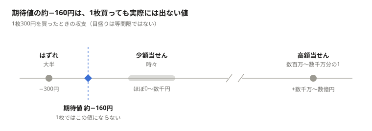
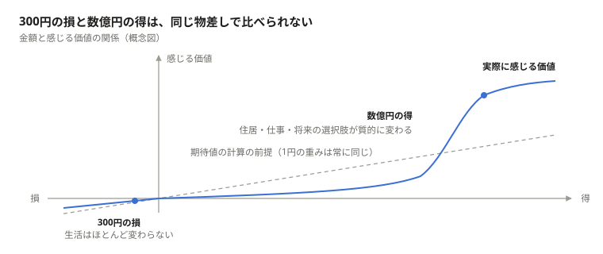
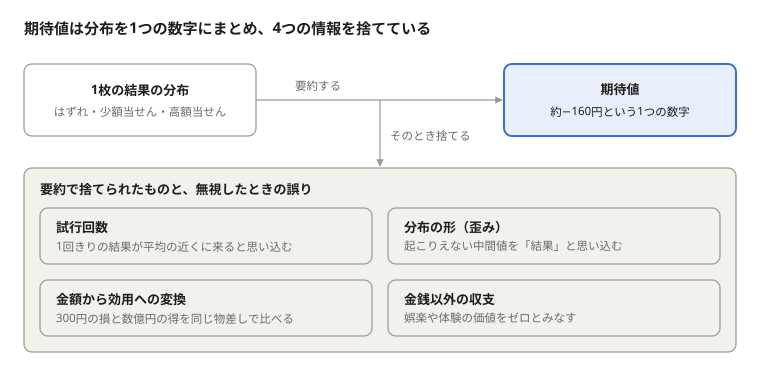

# 宝くじ1枚の期待値はなぜ判断を誤らせるのか

「宝くじは期待値がマイナスだから買うのは愚か」。計算そのものは正しい。それでも、この一言から「だから1枚も買うべきではない」を導くと、推論が飛躍する。買わないという結論が妥当な人は多いが、期待値の符号だけではそこまで言えない。

飛躍の原因は数字ではなく、数字の読み方にある。期待値という統計量が何を表し、何を切り捨てた要約なのかを確かめずに使うと、正しい数字から誤った結論が出てくる。本稿では宝くじ1枚を題材に、その飛躍を4つの論点に分けて整理する。

日本の宝くじは[当せん金付証票法](https://hourei.net/law/323AC0000000144)第5条で、当せん金の総額が発売総額の5割を超えないよう定められている。1枚300円なら期待値は概算で140円前後になり、差し引き約マイナス160円が「期待値マイナス」の中身である。

## 論点1：1回きりの試行と期待値

1枚買ったとき、マイナス160円という結果は決して起こらない。実際に起こるのは「ほぼ確実に300円を失う」か「ごく稀に高額が当たる」のどちらかで、期待値はその間にある、実際には起こらない値にすぎない。

> **図の内容**: 「期待値の約−160円は、1枚買っても実際には出ない値」（1枚300円を買ったときの収支。目盛りは等間隔ではない）
> - はずれ（大半）: −300円
> - 少額当せん（時々）: ほぼ0〜数千円
> - 高額当せん（数百万〜数千万分の1）: +数千万〜数億円
> - 期待値 約−160円は、はずれと少額当せんのあいだに位置するが、1枚ではこの値にならない。

実際の結果は「はずれ」「少額当せん」「高額当せん」のどれかで、期待値の約−160円はそのどれとも重ならない。

期待値が「現実の手取り」に近づくのは、大数の法則がはたらくほど試行を重ねたときだけだ。宝くじは分布が極端に右に歪んでおり、高額当せんを含む平均に収束するには、一人の人生では到底足りない回数が要る。1枚買った人の大半が経験するのは、期待値の約−160円ではなく−300円である。

ただし、1回きりだから期待値が使えない、というわけではない。お金の増減をそのまま価値とみなす人（リスク中立の人）にとっては、1回きりの選択でも期待値が正しい判断基準になる。1回きりの選択で問題になるのは、平均ではなく分布そのものが結果になることと、その分布を人がどう評価するかという好みのほうだ。この好みの話が、論点2につながる。

ここで捨てられている情報は「試行回数」と「分布の形」である。

## 論点2：金額と効用

期待値の計算は「1円の重みはいつでも同じ」と仮定している。だが人が実際に感じる価値（効用）は、金額に比例しない。

300円を失っても生活はほとんど変わらない。一方で数億円が当たれば、住居、仕事、家族の将来といった選択肢が質的に変わる。前者は誤差、後者は人生の分岐であり、両者を同じ物差しの足し引きで比べること自体に無理がある。

経済学ではこれを期待効用の問題として扱う。保険に入る人が同時に宝くじも買うという一見矛盾した行動も、金額の大きさによって効用の曲がり方が変わると考えれば説明できる（フリードマン＝サベージの仮説）。

> **図の内容**: 「300円の損と数億円の得は、同じ物差しで比べられない」（横軸が損得の金額、縦軸が感じる価値の概念図）
> - 点線は期待値の計算の前提（1円の重みは常に同じ）で、まっすぐな直線。
> - 実際に感じる価値の曲線は、300円の損のあたりではほぼ平らで「生活はほとんど変わらない」。
> - 数億円の得のあたりで急に立ち上がり、「住居・仕事・将来の選択肢が質的に変わる」。

期待値は点線のような直線を前提にしているが、実際に感じる価値は小さな金額ではほとんど動かず、生活が変わる金額で大きく動く。

ただし、この非対称は損の側と得の側で分けて考える必要がある。300円程度の損なら、感じる価値はほぼ金額に比例するので、損の側は期待値の物差しで測って問題ない。ずれが生じるのは、生活を変えるほどの当せん金の側だけだ。また、効用がこの形をしているからといって、買う判断が合理的になるとは限らない。数千万分の1という確率を掛けてもなお、得の側の価値が300円の損を上回るかどうかは、人によって変わる。

ここで捨てられている情報は「金額から価値への変換」である。

## 論点3：買う行為そのものの価値

期待値は当せん金だけを数える。抽せん日までの「当たったら何をしよう」と考える時間や、家族や友人との話題は計算に入らないが、買う行為そのものにも価値がある。

映画のチケットやカフェのコーヒーも、金銭的な期待値で見れば全額マイナスだ。それでも誰も「期待値がマイナスだから映画は観ない」とは言わない。対価として体験を買っていると理解しているからである。宝くじも同じように見ると、300円のうち平均で約160円が、この楽しみへの実質的な支払いにあたる。160円に見合う楽しみがあるかどうかが、買うかどうかの問いになる。

ここで捨てられている情報は「金銭以外の収支」である。

## 論点4：逆向きの誤読

ここまでの話は「だから宝くじは賢い買い物だ」という意味ではない。期待値を捨てて直感だけで判断すれば、今度は反対側に誤る。この逆向きの誤読にも気をつけたい。

- **習慣化すると損失が確実に積み上がる**。毎回買い続ければ、損失はほぼ確実に増えていく。しかも、典型的な購入者の損失は期待値から見込む額（1枚あたり約160円）より大きくなる。期待値には高額当せんの分が含まれているが、ほとんどの人はそれを受け取らないまま買い終えるからだ。1枚と100枚は別の意思決定である。
- **人は小さな確率を過大評価しやすい**。プロスペクト理論が示すように、数千万分の1を「もしかしたら」と実際より大きく感じる傾向がある。論点2の効用の話を、この錯覚の言い訳にしてはいけない。
- **投資と混同しない**。娯楽費として払える額かどうかが基準であり、資産を増やす手段として期待するのは期待値の誤読そのものだ。

期待値は捨てるべき数字ではなく、使う場面を選ぶべき数字である。

## 結論：統計量の読み方

数字はウソをつかない。要約を読み違えた人間がウソにする。

期待値は、ばらばらな結果の分布をたった1つの数字に圧縮した要約だ。要約である以上、必ず何かを捨てている。宝くじの例で捨てられていたのは次の4つだった。

> **図の内容**: 「期待値は分布を1つの数字にまとめ、4つの情報を捨てている」
> - 1枚の結果の分布（はずれ・少額当せん・高額当せん）を要約すると、期待値（約−160円という1つの数字）になる。そのとき捨てるもの:
> - 試行回数 — 1回きりの結果が平均の近くに来ると思い込む
> - 分布の形（歪み） — 起こりえない中間値を「結果」と思い込む
> - 金額から効用への変換 — 300円の損と数億円の得を同じ物差しで比べる
> - 金銭以外の収支 — 娯楽や体験の価値をゼロとみなす

同じ構造は日常のあちこちにある。平均年収は一部の高所得者に引っ張られ、多くの人の実感より高く出る。降水確率30%は「3割の時間雨が降る」ではない。どれも数字は正しく、間違えるのは読み手のほうだ。

統計量を使うときに問うべきは「この数字は何を要約し、何を捨てたのか。捨てたものは今の判断に関わるのか」である。宝くじ1枚を買うかどうかは、期待値ではなく、その問いに自分で答えたうえで決めればいい。
